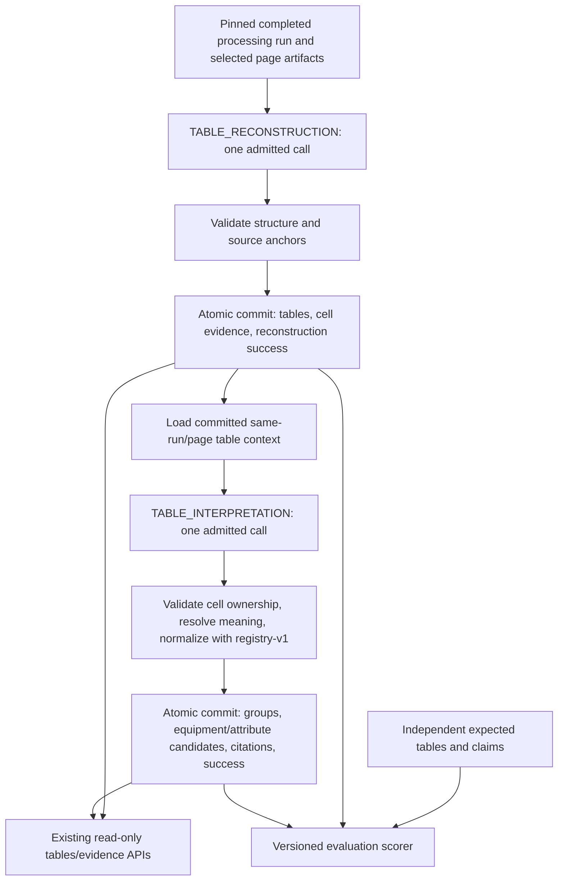

# Phase 6D implementation plan — Tables and schedules

**Status:** M1–M3 implemented; M3 awaits review before M4. M4 remains pending. Actual delivery, identities, bounds and checks: [M1 handoff](PHASE6D_M1_HANDOFF.md), [M2 handoff](PHASE6D_M2_HANDOFF.md) and [M3 handoff](PHASE6D_M3_HANDOFF.md). Date: 2026-11-05 (America/Vancouver).

**Baseline:** planning refreshed `origin/main` at `ce12a8f2d26a18f3935450eaaa59552435d8925a`, including all accepted 6C work and the live-evaluation provenance correction. Implementation branch `codex/phase-6d-tables-schedules` was created after M1 approval from refreshed `main` at planning commit `1b0afd11a34e35c3bb682b5af28f348f64371587`, carrying the approved review clarifications. The user-supplied 6D prompt is preserved unchanged.

**Authority:** [6D prompt](prompts/phase-6d-prompt.md), [approved Phase 6 specification](specs/phase-6-evidence-structured-extraction.md), [ADR-008](../decisions/ADR-008-evidence-candidate-extraction-architecture.md), accepted [6A](PHASE6A_HANDOFF.md), [6B](PHASE6B_HANDOFF.md), [6C plan](PHASE6C_PLAN.md) and [6C handoff](PHASE6C_HANDOFF.md). Current extraction/provenance/architecture/roadmap documentation and the actual contracts, database guards, execution, provider, interpretation and tests were inspected. Historical documents and frozen registry-v1 remain unchanged.

**Approved design choice:** the first 6D production profile is table-only, as explicitly confirmed by the user. Extracting both tables and ordinary prose from a document requires separate runs: a 6D table run and an existing 6C engineering run. Neither run replaces or combines the other's results. The four proposed milestones are retained, sequentially, with a review gate after each. No combined table/prose workflow is included in this release. M1–M3 were subsequently authorized explicitly; M4 still requires its review gate.

## 1. Selected architecture

Add an explicitly selected, versioned table profile with two required page stages:

`TABLE_RECONSTRUCTION → TABLE_INTERPRETATION`

The first stage discovers all bounded tables on a selected page and preserves admitted structure and source evidence. It commits `ExtractedTable` records and table/cell evidence, without equipment or attribute candidates. The second stage consumes only the unique committed reconstruction for the same run/page and publishes source-local groups and relational equipment/attribute candidates citing those cells. Deterministic code, rather than model proposals, decides admissibility, associations and registry normalization.

Use the existing coordinator, claims, durable notifications, worker, provider interface, leases, accounting and atomic publisher. This is a second fixed two-stage page plan, not a new scheduler or general workflow engine. Multiple tables on a page share one reconstruction call and one interpretation call; no hidden per-table calls or repair calls are allowed.

Proposed profile names are `tables-openai-v1` and `tables-openai-text-v1`, plus explicit synthetic profiles for tests. The hybrid profile selects existing native text and analysis images, including image-only pages; the text-only profile requires native text. Both are table-only. The fake default, external-processing opt-in and manual initiation remain unchanged.

## 2. Alternatives and rationale

### Option A — Dedicated table profile with two stages: selected

- **Ownership and duplicates:** table-contained claims have one producing interpretation stage. No ordinary 6C recognition/attribute stages run alongside it. This avoids overlapping extractors within the run.
- **Dependencies and context:** reconstruction commits before interpretation; cell IDs, table structure and evidence are stable and reloadable. The second model receives a bounded projection of those exact results, not another independently reconstructed table.
- **Calls and retry:** normally two calls per selected page. An interpretation retry reuses reconstruction; one attempt still permits at most one call. Several tables do not multiply the stage count.
- **Partial failure:** successful layouts remain inspectable when interpretation fails. Failed reconstruction blocks interpretation without spending a downstream call. Empty reconstruction produces a valid empty interpretation completion without calling the provider.
- **Compatibility and future work:** new profile/schema/runtime identities leave 6C meanings intact. OCR or verified region inputs can later enter the same versioned table admission boundary.
- **Trade-offs:** reconstruction is retried at page granularity, and the page may be resent for interpretation. Prose outside the table is intentionally absent from this profile. These are acceptable initial limits.

### Option B — New combined table and ordinary-engineering profile: deferred

A safe combined plan would reconstruct tables before ordinary extraction, give the ordinary stages an enforceable table-exclusion policy, and interpret the table separately. That is typically four page calls (reconstruction, ordinary recognition, ordinary attributes, table interpretation), or at least three with newly combined ordinary semantics. It adds failure branches and retry dependencies.

Native offsets can support precise exclusion of a verified table block, but an image-only page has no independently verified table polygon. Passing a model exclusion label or masking a guessed rectangle cannot prove that ordinary extraction avoided the table. Duplicate claims could survive or legitimate prose could be lost. Running 6C first and deduplicating later also conflicts with immutable already-published successes. This option handles mixed-content documents in one run, but its overlap and provenance cost is unnecessary for the agreed first release.

### Option C — One table call followed only by deterministic conversion: not selected

A single response can contain structure and proposed claims, and deterministic interpretation must always be used. This would reduce normal calls to one per page. However, table structure and semantic observations would be coupled in one publication/retry unit: malformed semantic output would prevent a useful reconstruction from becoming an independently committed prerequisite, and retry would repeat discovery. The selected split gives a clearer structural contract and partial-result boundary. It does not prevent deterministic resolution from doing most of the semantic work after the second call.

Two specialized calls are the initial cost/inspectability trade-off, not a promise that every model or table needs two calls forever. A future one-call optimization would be a new explicit profile, measured against the same corpus.

## 3. Observation and immutable layout contracts

M1 adds provider-neutral, strict, versioned Pydantic observations and prompts for both stages. Responses are observations, never ORM objects or model-generated persistence DTOs.

**Reconstruction observations** describe response-local table/row/column/cell references, exact raw content, titles/captions, header roles and relationships, row/column spans, source-role anchors and explicit uncertainty/truncation. They can represent `EQUIPMENT_ROWS`, `ATTRIBUTE_ROWS`, `MIXED` and `UNCLASSIFIED`, including several independent tables per page. A consistent equipment-row schedule can contain different equipment types without automatically becoming MIXED.

Validate unique references, distinct row/column identities, valid grid positions, nonoverlapping occupied spans, acyclic/consistent header relationships and available source roles. Merged cells are single spanning cells, not copied values in every covered slot. Distinguish an observed empty string from an absent/unreadable cell. Do not generate a blank cell or a missing-value candidate to fill a gap. A model observation claiming a table with no supported cells is rejected; an empty page-level table list is valid.

**Interpretation observations** reference committed table/cell local aliases and propose equipment contexts, attribute readings and associations. They cannot add or change upstream cells, text, spans, headers, orientation or titles. Attribute readings can cite a value cell plus separately identified label, unit, qualifier and equipment-context cells. Unknown meanings and null equipment associations remain representable.

Retain `TableInput`, `TableLayout`, `TableCell`, `TableKind` and `table-layout-v1` as the persistence representation. Typed, versioned table-specific metadata can record admitted header relationships, per-cell anchor/evidence references, structural reliability, incomplete readings and reasons. Core engineering facts stay in relational candidates. Existing metadata/response limits apply; metadata is not an unbounded raw-response store.

The immutable table kind is the admitted first-stage orientation hint. If global orientation is unresolved, store UNCLASSIFIED; interpretation can still retain justified local readings without rewriting the table or treating the hint as proof. Mixed or incomplete layout is not repaired into a convenient rectangular schedule.

M1 must define and measure explicit per-page/per-table limits for tables, rows, columns, cells, header references, claims and serialized response/context bytes. Reuse the existing 2,000-character cell/excerpt bound and the established publisher limits. Measure representative fixture payloads before fixing production defaults. Token/context overflow fails explicitly; never silently drop trailing rows or tables to fit. Final bounds and measurements are part of the M1 review gate and later profile identity.

## 4. Grounding: text content and table relationships are separate

Use exact completed processing/artifact descriptors from the selected run/page. Verify real object size/hash, UTF-8 and PNG dimensions/pixels before provider execution. Never use mutable page text counts or current processing as historical evidence. No new source artifact type, OCR engine or layout-preprocessing pipeline is introduced.

### Native text

Verify literal cell/header/caption excerpts against the pinned native artifact. Resolve unique occurrences and calculate codepoint offsets server-side; unresolved repeats retain limited text/page grounding. Model offsets, UUIDs and coordinates are never accepted as authoritative.

**A correct quote proves text occurrence, not a row/column association.** Admit a native structural relationship deterministically only when the source has an unambiguous supported representation, initially explicit tab/pipe-delimited contiguous rows with consistent boundaries and header relationships. This parses text already inside a PDF artifact; it is not CSV/XLSX ingestion. Ordinary whitespace, PDF extraction order, matching values and model row indices alone are insufficient. Do not add fixed-position PDF geometry reconstruction in 6D.

If literal text matches but structure cannot be established, preserve a limited/unclassified table observation where its source is admitted. Keep uncertain claims detached/UNMAPPED, or use a separately supported visual reading when an image was pinned. Do not label unverified row relationships as native-text verified simply because every individual token occurs somewhere on the page. Fabricated literal text assertions are rejected with bounded diagnostics.

### Visual and hybrid inputs

Carry forward the accepted 6C policy: source-supported, registry-valid visual candidates may be MAPPED while explicitly marked as visual reports with page-level grounding. A model-reported table grid is an interpretation, not verified image geometry. Image evidence has null native snippets/offsets/coordinates and `text_verified=false`.

Distinguish at least verified native text, deterministically established native structure, visual-reported structure and unresolved association. A hybrid table can have verified native cell text and visual-reported relationships; these are separate reliability facts. Neither token matches nor native modality may upgrade the structural claim. Units and equipment contexts must be supported within the same admitted reading; do not borrow a native number's qualifier from a conflicting visual interpretation.

Preserve conflicting readings as explicit source-local variants, with their original modality/anchors. If one faithful layout cannot represent both readings, retain distinct table variants rather than selecting an arbitrary cell value or combining incompatible grids. Only collapse genuinely identical observations of the same admitted source occurrence; never merge by tag or normalized value.

## 5. Interpretation and source-local grouping

Introduce a versioned table interpretation adapter accepting an admitted structured bundle of cells, header paths, equipment context and qualifiers. Reuse frozen 6C meaning/qualification/value helpers where their preconditions hold, the existing registry projection/terminology and `normalize_attribute_value()`. Do not copy the registry catalog, change registry-v1, or weaken the existing prose interpreter's source checks.

Labels, values and units may occupy different cells. A server-rendered combination of them is derived semantic context, not a verbatim source quote. Never feed an invented `Secondary Voltage: 600 V` passage into native verification or publish it as a snippet when the source contains separate cells. Keep exact cell text as raw source content, cite each contributing component and record where the source unit came from. The new adapter has its own identity and pins the frozen 6C helpers it uses; old prose behavior remains unchanged.

**Equipment rows:** one admitted row occurrence gets its own mention/group when supported. Type can come from that row or an explicitly scoped table caption/header. Tagless and unknown-type rows remain possible. Subtotals, notes and arbitrary numeric rows do not automatically become equipment. Values associate only through the admitted row/header structure, never merely through the second model's equipment reference.

**Attribute rows:** share one equipment group only when the table establishes a unique equipment context. A tag in an arbitrary nearby cell is not sufficient. Several possible equipment contexts leave links null or require explicitly partitioned substructures; no nearest-cell fallback.

**Headers and semantics:** combine unambiguous header paths, retaining qualifiers and explicit units. Conflicting unit declarations, ambiguous `Rating`, unsupported normal/emergency conditions, unresolved hierarchical scope and nonunit parentheticals remain unresolved rather than being stripped. Keep breaker AF/AT, transformer normal versus zero-sequence/per-unit impedance, and utility three-phase versus SLG current/X/R distinct. Mapped fields require a justified registry equipment type/key and exact typed normalization. Retain UNMAPPED/INVALID readings and raw conflicts without selecting a winner.

For the prompt's TX-1/TX-2 schedule, a source caption such as **2-Winding Transformer Schedule** can justify type context; `Secondary (V)` plus the TX-1 value cell `600` can then yield `0.6 kV`, with separate citations to value, header and equipment context. TX-2's `480` must remain in its own row/group. If only `TX-1` and generic ratings are present, do not infer a transformer subtype from the tag prefix. The same rule applies to the attribute-row example: preserve it without forced mapping if no source establishes equipment type.

Revision-wide frequency/phase count remain manual-only. Source-local, registry-supported equipment statements may be candidates; no revision-metadata proposals, canonical lookups, physical identity inference or canonical writes are permitted.

## 6. Cell identity, cross-unit references and publication

Server-owned table/cell/evidence identities derive from the run, logical page-stage identity and admitted local references/source occurrence. A tag is not an identity. IDs remain stable for a committed output and across downstream retries, not across unrelated re-extractions. The provider receives only bounded local aliases; server code resolves them to immutable IDs.

**Reconstruction output:** publish tables and bounded table/cell evidence together with the stage success marker. Table-level `evidence_ids` need only summarize the table; individual cell evidence records use `table_id`/`cell_id`. Do not put every cell in the table's capped evidence-ID list. A cell locator must identify an actual persisted cell, including a spanning cell rather than one of its fictitious covered cells.

**Interpretation output:** publish groups, mentions, attributes and candidate/evidence links in one atomic unit. Prefer reuse of committed upstream cell evidence. A value citation is PRIMARY; contributing headers, units, qualifiers and equipment context are SUPPORTING as appropriate. This preserves evidence for derived meaning without inventing a single combined snippet. No table or cell is republished by interpretation.

Add a committed-table context loader analogous to 6C's recognition loader, with table-specific validation rather than reusing recognition's 32-mention assumptions. It must check the unique successful TABLE_RECONSTRUCTION unit for the same run/document/processing/page, exact pinned artifacts, table producer, validated metadata, cells and their evidence. Revalidate native text anchors against the loaded immutable text. Fingerprint the canonical upstream projection and retain upstream attempt identity in call correlation.

Existing composite FKs enforce same-run/document ownership, but current persistence cell validation primarily checks that a referenced cell exists. M2 must additionally enforce producer completion, page/artifact agreement between a table/cell and its evidence, and permitted upstream ownership. A completed table on another page is not sufficient. Candidate links to committed upstream evidence remain valid; links to foreign, failed, active, unrelated-page or unselected-artifact outputs must fail atomically. Do not rewrite historical outputs or remove legitimate same-run reuse.

Use `EvidenceSourceKind.TABLE_CELL` with real table/cell locators. Preserve native offsets only where established and visual null geometry. Extend evidence-summary precision resolution for table-cell evidence using actual source/offset metadata; the current helper otherwise falls back to PAGE_ONLY for TABLE_CELL. Keep text/page/visual precision vocabulary honest and expose structural reliability through bounded layout/candidate metadata. Do not imply that a cell ID is verified geometry. Signed evidence URLs must still resolve the exact historical artifact.

## 7. Ownership and duplicate policy

The confirmed first profile owns only tables and their directly scoped captions/headers/notes that qualify table claims. Such prose can supply context, but unrelated page prose does not create additional candidates in this run.

- Reconstruction owns structure/evidence; interpretation is the sole producer of equipment/attribute candidates. No 6C stages also extract those cells in the same run.
- Validate one interpretation per admitted claim occurrence/reading. A duplicate local reference is invalid; repeated equivalent proposals for the same table/cell/value span and qualifier context do not produce another candidate.
- A cell may legitimately contain several claims, such as distinct AF and AT clauses. Preserve them when their source substrings and meanings are separately supported; do not reduce ownership to one candidate per cell.
- Distinct rows, repeated tags, separate tables, different header/condition contexts and conflicting readings remain distinct. No deduplication by values, tags or canonical equipment identity.
- Interpretation retries reference immutable prior reconstruction and cannot recreate its tables or an already successful interpretation's candidates. Duplicate deliveries retain existing claim/publication fencing.
- Separate 6C and 6D runs remain separate result histories. Do not globally combine/deduplicate them in the existing candidate API or silently hide one run's observations. A future combined profile requires its own ownership design and version.

### Document-level summary across profiles

Preserve the existing `ExtractionReadService.summary()` behavior for 6D. It considers all applicable profiles for the document, ordered by run creation time descending with the run ID as tie-breaker. `latest_result` selects the newest COMPLETED or PARTIALLY_COMPLETED run; `current_run` selects the newest run regardless of status. Neither field is a profile-specific result selector or a cumulative document-wide extraction view.

For example, completed 6C run A followed by completed 6D table run B makes B the document's `latest_result`, even though A's prose results still exist. The same is true if B is PARTIALLY_COMPLETED after reconstruction succeeds but interpretation fails. While B is pending/running, or if it fails/is cancelled without a later eligible result, `current_run` can identify B while `latest_result` remains A. A completed table run with no detected tables can also become the latest result; that does not mean A's prose candidates disappeared.

Both runs must remain discoverable in paginated `GET /extraction/runs`, and each run's candidates, tables and evidence must remain accessible by its run/evidence IDs under existing membership checks. Consumers should use run/profile identity and coverage to choose which results to display. This release does not add per-profile summary fields, merge outputs across runs, or redesign the summary API. Document this behavior in the delivery handoff and current extraction documentation.

The M3 acceptance gate must include an actual same-document 6C/6D sequence proving summary selection and access to both histories/results, including partial table output. Cover reversed profile order, a newer non-result status and an empty successful table run; test history pagination so the previous profile's results are not effectively hidden on another history page. Re-read the older run and its signed evidence after the summary changes to prove that it remains intact.

## 8. Execution, profiles and historical compatibility

Use a new `execution-profile-v4` table profile/read path and dedicated table manifest/runtime/provider-input identities. Do not widen the accepted 6C `EngineeringProfile` stage tuple or relabel its `EQUIPMENT_RECOGNITION → ATTRIBUTE_EXTRACTION` plan. Proposed new resources are `table-stage-manifest-v1`, table observation schemas/prompts, table grounding/interpretation identities and `table-page-runtime-v1`; exact names are finalized in M1 and material settings are pinned in M3.

Extend planning and dispatch through a small explicit profile-family dispatch: existing probe plan, existing 6C plan and the new fixed table plan. A table profile must not fall through to a probe or 6C schema. The existing SQL prerequisite gate can enforce a reconstruction key; reuse it rather than relying on broker order. The existing one-level retry-eligibility algorithm is adequate for another fixed two-stage plan; do not turn it into arbitrary DAG execution.

Precreate both required logical units per selected page. Waiting interpretation consumes no admission. Reconstruction failure/exhaustion settles blocked interpretation before parent aggregation; a pending bounded upstream retry keeps it waiting. Successful reconstruction survives downstream failure and is reused for automatic/manual retry. After an ordinary budgeted, leased claim, empty admitted table output can settle interpretation successfully and atomically without provider I/O. Retain the normal admission charge and publication token/fence; do not introduce a second unbudgeted completion path. A bounded skip diagnostic distinguishes deliberate empty completion from a missing provider report, and no call row or fabricated zero usage is emitted. This is a versioned table-only optimization; 6C empty recognition behavior remains unchanged.

For P selected pages the normal plan needs 2P admissions before retries and makes at most 2P calls, fewer when interpretation has no tables to process; retries consume the original pinned budget. Admission/call/skip counts remain distinct and conservative aggregate usage must not be presented as known when the existing accounting leaves it unknown. No per-table fan-out or opportunistic repair calls. Preserve page/input/context/output/image/attempt bounds, global/per-run concurrency, timeouts/deadlines, transient storage categories, expiry-first recovery, durable notification, append-only attempts, cancellation and stale-worker fences. Do not finalize a parent while any required or optional work is active. Read coverage distinguishes committed layouts from completed claim interpretation.

Load exact source objects outside metadata transactions. Load/check upstream context in a short transaction; render bounded untrusted context and perform provider I/O outside it. Preserve the publisher's existing independent source verification safeguard. Use the current Responses structured-output transport with trusted schema selection, SDK retries disabled, `store=false`, no tools, sanitized errors and honest known/unknown usage. Keep instructions separate from document/table content. The table input envelope and allowlists have their own version/hash.

### Runtime identity work is mandatory, not a fixture refresh

The existing 6C runtime hashes include whole `profiles.py`, `stage_runtime.py`, `dependencies.py`, `orchestration.py` and `execution.py` sources; production also pins its adapter resource. Adding dispatch to a shared file would otherwise invalidate old configurations even if their branches behave identically.

Before changing any fingerprinted shared file, retain the baseline source bytes needed by both accepted runtime readers, including the already retained M4 resources. Give old readers explicit retained identity inputs while preserving their executable branches; new table behavior gets new resources and a new runtime. Archive resources are identity data, never dynamically executed source. Avoid editing frozen M1–M3 resources or prose interpreter files. If a genuinely shared algorithm must change, preserve a compatible version-specific behavior path rather than merely teaching old hashes to accept new semantics.

Require byte-identical v1/v2/v3 profile wire JSON/hashes, unchanged 6C manifest/interpretation/grounding/runtime fixtures, old active-run claim/retry support, immutable historical reads and built-wheel identity reproduction. Add old-active-run regressions in addition to snapshots. Do not regenerate accepted fixtures to conceal drift. Unknown resources fail explicitly; no fallback to latest behavior.

## 9. Package/service changes and storage/API impact

- **`packages/extraction`:** table observations, stage resources, layout/source admission, table interpretation adapter, output conversion, committed-table context, profile/runtime dispatch and fixed-plan integration. Reuse existing contracts/models/persistence and add the narrowly required table/cell reference checks. Preserve old source semantics and resource readers.
- **`packages/ai`:** the generic selected-response envelope should already carry table stage schemas. Change only if a demonstrated missing capability requires an additive provider-neutral field; no SDK/domain imports cross this boundary.
- **Extraction worker:** explicit table-profile provider selection and versioned input validation using the existing Responses transport, plus synthetic/scripted test support. Keys stay worker-only. No independent SDK evaluation path.
- **API:** advertise new production profiles through existing discovery/start contracts; continue existing tables/candidates/evidence/history APIs, membership, pagination, effective-unit filtering and signing. Correct table-cell precision summaries without changing old source-kind meanings. No new route is currently justified.
- **Settings/Compose:** pin any necessary table-specific context/output/structure limits separately from the probe/6C defaults; pass them consistently to API, worker and scheduler. New settings do not change old profile serialization or select tables automatically.
- **Tests/evaluation/docs:** independent table fixtures, negative controls, offline replay/scoring, integration coverage, package identity checks, milestone handoffs and final `PHASE6D_HANDOFF.md`. Update current architecture/extraction/provenance/roadmap/status at delivery without rewriting accepted historical handoffs.

No new entity/table or database migration is currently needed: stage keys are strings, profile configuration/metadata are versioned JSON, and table/cell/relational candidate storage already exists. Keep `table-layout-v1`; stronger producer validators and additive bounded metadata do not require changing its DB check. If implementation demonstrates a database constraint cannot safely represent a required invariant, document the concrete conflict before proposing a forward migration; never edit migrations 0011–0013 or weaken their history/fencing guards.

The prompt defers spreadsheet ingestion to Phase 6.5 after 6G and before 7. Document that placement in current planning/status when reconciling the roadmap; it authorizes no ingestion work here. No new upload formats, UI changes, OCR/layout engine, full multi-page stitching, entity resolution, topology, reconciliation or acceptance/verification is included.

## 10. Four milestones and review gates

### M1 — Offline table observations, stages and layout interpretation

Deliver strict reconstruction/interpretation schemas, source-role/local-reference contracts, headers/spans/uncertainty, deterministic structural validation and orientation policy, versioned prompts/identities and registry context. Use representative synthetic response fixtures for all four orientations and several tables per page. Establish measured response/context bounds and pin the intended structural reliability metadata contract.

**Gate:** offline tests cover equipment rows, attribute rows, mixed/unclassified layouts, sparse/blank cells, merged/hierarchical headers, repeated headings, malformed/duplicate/cyclic references, overlapping/out-of-range spans, unavailable roles, empty responses/tables, unsupported assertions and size/overflow. Exact raw strings and no fabricated cell filling are demonstrated. Resources load and hash from a built wheel; existing 6C identities/import boundaries remain unchanged. No DB/provider execution or profile registration yet.

**Delivered:** strict reconstruction/interpretation observations, sparse-grid/header validation, conservative unverified layout inspection, bounded offline context and server metadata contracts, three prompt resources and reproducible identities. Bounds are eight tables/512 cells per page, 128 rows/32 columns per table, 64 equipment/256 attribute claims, 1 MiB/512 KiB response bytes and 128 KiB instructions/context. A 512-cell structural probe produces 98,355 context bytes; instructions are 8,030/66,699 bytes. After the unreadable-value-cell review correction, all 79 M1 offline cases pass within a 340-test related suite (two integration cases explicitly deselected). Wheel identities, old v1/v2/v3 profiles and exact 6C replay reproduce. No source admission, normalization, publication or production execution is implemented by M1. See [PHASE6D_M1_HANDOFF.md](PHASE6D_M1_HANDOFF.md).

### M2 — Grounding, table interpretation and publication conversion

Deliver exact-source admission with separate text/structure reliability, the structured-cell interpretation adapter, source-local groups, `TableInput`/cell evidence/candidate conversion and the committed-table loader. Reuse registry normalization and 6C conservative qualifications without manufacturing quotations. Add cross-unit table/cell producer/page/artifact checks and any read-summary precision handling needed for cell evidence.

**Gate:** deterministic native and visually limited fixtures produce correct layouts, claims and citations. Prove TX-1/TX-2 isolation, single-equipment table scope, explicit type context, tagless/unknown/detached observations, header-unit normalization, exact large integers/Decimal/false/enums/text, ambiguous Rating/qualifiers, AF/AT separation, conflicting/blank cells and no guessed defaults. Wrong local IDs, forged structure, mismatched modality/occurrence, unrelated captions and foreign/active/failed/page-mismatched upstream references cannot establish ownership. Image-only output has no fabricated offsets/geometry. Real disposable PostgreSQL publication/read tests prove atomic rollback, committed upstream reuse, locator integrity, historical artifact signing and immutable outputs. No production OpenAI/orchestration registration yet.

**Delivered:** exact pinned reconstruction admission, separate text/structure reliability, structured-cell registry interpretation, source-local groups, existing layout/evidence/candidate conversion, committed-context revalidation, table/cell publication ownership checks and honest evidence precision through existing APIs. Deterministic and real disposable PostgreSQL tests exercise associations, normalization, rollback, immutable history and artifact signing. M2 review corrections inspect full identity cells for multiple tags and preserve distinct conditional readings/qualifiers/association proposals while retaining scalar/AF-AT deduplication. Production profiles/orchestration remain unregistered. See [PHASE6D_M2_HANDOFF.md](PHASE6D_M2_HANDOFF.md) for actual validation and conservative limits.

### M3 — Production profiles, OpenAI and fixed-plan orchestration

Deliver v4 table profiles and explicit stage/runtime/provider dispatch through the existing coordinator, worker and APIs. Pin context, model, transport and resource limits. Add durable dependent execution, empty-table settlement, dependency-aware retry/partial completion and safe production discovery under existing opt-in controls. Implement the retained-resource compatibility strategy before shared fingerprinted edits. The gate also requires the cross-profile summary/history/result-access cases defined in section 7; selecting a newer table summary must not make the earlier 6C results inaccessible.

**Gate:** actual SDK serialization/parsing runs over mocked transport with the exact selected schemas, untrusted inputs and usage/error limits. Real Celery/beat/Redis/PostgreSQL/MinIO tests prove table publication before interpretation, two calls for a nonempty page, zero dependent calls for empty tables, no per-table fan-out, blocked failure settlement, call-budget exhaustion, cancellation, expired leases, duplicate delivery, worker interruption/restart and interpretation retry without repeating reconstruction or duplicating candidates. Layouts remain readable after downstream failure. Test partial runs and cross-unit evidence through public APIs, no canonical mutations, and prior 6C/fake/probe active execution plus byte-identical identities. No paid calls in tests.

**Delivered:** v4 table-only production/synthetic profiles, fixed-plan dispatch through the existing coordinator/worker/Responses adapter, committed context and correlation, budgeted empty-table completion, opt-in discovery/settings and retained 6C runtime identity inputs. Real worker/beat/Redis/PostgreSQL/MinIO tests cover production SDK requests via mocked transport, retry/restart/cancellation, multiple tables without fan-out, empty skips and cross-profile history/summary access. Old accepted configurations still claim/retry/publish. Actual verification and limits: [PHASE6D_M3_HANDOFF.md](PHASE6D_M3_HANDOFF.md).

### M4 — Table evaluation, full regression and final handoff

Deliver an independently annotated synthetic/anonymized corpus and versioned table scorer/replay that understand layout as well as claims. Cover transformer, LV breaker AF/AT, cable and utility schedules; single-equipment specifications; mixed tables; repeated tags/headers; blank/missing cells; merged/hierarchical headers; ambiguous association; conflicts; several tables per page; native, visual and hybrid evidence; and negative tabular-looking content. Include unknown types and tag-prefix-only contexts that must not map.

Match tables by source occurrence/anchors and cells by declared independent structure, not by proposed keys, normalized values or provider IDs. Report table precision/recall, row/column counts and order, cell content and spans, header relationships, orientation, equipment precision/recall, attribute detection/mapping, exact values/units, association, table/cell evidence, false/duplicate claims and UNMAPPED/INVALID retention. Separate literal-text, visual-report and relationship reliability. Gold tables/cells/claims remain in denominators after omissions or failed stages; expose coverage and null empty denominators. No arbitrary accuracy threshold or live-quality claim from scripted outputs.

Extend evaluation via a separate versioned table entrypoint/resources so the existing 6C evaluator's source hash and committed baseline remain reproducible. Reuse immutable compatible helpers where appropriate; do not edit its frozen scoring policy to fit table outputs. New corpus provenance must distinguish synthetic from properly anonymized sources. An optional live path must explicitly bind approved artifacts and selected pages, budget actual stages, use the production coordinator/provider path and retain the provenance hardening that injected providers cannot claim LIVE_OPENAI. It is not an arbitrary private-document import/bulk benchmarking feature.

**Gate:** full relevant backend regression passes with required real integrations and no hidden skips; existing identity fixtures and 6C scripted baseline remain valid. Verify wheels/direct imports and packaged resource identities, fresh/migration/schema checks as applicable, OpenAPI/API reads, lint, formatting, dependency and whitespace checks. Record actual commands/results and limitations in `PHASE6D_HANDOFF.md` and current docs. Live evaluation is optional and requires separately authorized fixtures/provider access; none is authorized by this planning task.

Each milestone ends with a reviewable commit/branch state and a concise handoff describing components, actual checks, remaining limits and gate status. Do not start the next milestone before its review gate is accepted. Do not label 6D complete before M4 and its final handoff pass.

## 11. Focused test strategy and risks

Prioritize failures that can silently put a correct value on the wrong equipment: swapped columns/rows, repeated values/tags, model cell references outside their table, a missed intervening header, unit inheritance across unrelated groups, merged headers crossing equipment boundaries and captions naming another device. Verify expected rejection/detachment as well as successful mapping.

Use independent authored gold and mutation tests that deliberately change structure, interpretation, units, source offsets, page/artifact IDs, references and groups. A correct-looking normalized value must not earn credit when attached to the wrong cell or equipment. Test malformed/overflowed responses as failed atomic stages; test genuinely uncertain but admitted content as inspectable limited output. Separate these cases from model-invented text assertions.

For integration, use disposable infrastructure and actual SDK transport mocks, following the 6C worker/beat fixtures. Verify both reconstruction and interpretation savepoint rollback, same-run committed context, stale output after cancellation, exact typed HTTP serialization, partial coverage and SELECT-only reads. Keep normal development data untouched. Run broad regression at the M4 gate and meaningful targeted regressions after each milestone; expand earlier only for demonstrated shared-path changes.

Key risks and mitigations:

- **Native text order is not geometry:** require explicit structural proof or honest visual/unresolved status; accept potentially lower text-only recall and measure the impact on representative processed PDF schedules at M4 rather than relying only on delimiter-friendly fixtures.
- **Model-reported visual structure is not independent verification:** retain page-level markers, no coordinates/OCR claims, and separate structural reliability from text matching.
- **Context growth on large schedules:** bounded page-level responses/projections, measured payloads and explicit overflow; no truncation or unaccounted fan-out. Very large schedules may need later versioned partitioning.
- **Overconfident type/header interpretation:** require explicit scoped type/meaning, retain ambiguous/conditional claims and preserve raw cell/context evidence.
- **Historical runtime drift:** retain actual baseline identity inputs and behavior branches, with old-active-run and wheel tests; do not update accepted hashes as a shortcut.
- **Cross-unit references that are same-run but wrong-page:** revalidate producing success, stage, exact page/artifact and cell ownership at load and publication.
- **Duplicate observations across extractors:** table-only ownership is confirmed; keep separate 6C/6D run histories, with no premature physical identity merging.
- **Unmeasured model accuracy:** independently labeled table corpus and honest scripted versus live reports. Existing 6C's 1,487-test full run and 45-test provenance follow-up are historical evidence, not results executed for this plan or proof of table accuracy.

Full multi-page table stitching is deferred. Each page's continuation/header reading is preserved independently; no cross-page equipment merge or inherited missing heading is invented. Phase 6E may later provide versioned OCR and verified regions to this admission boundary; Phase 6F supplies broader UI/evaluation infrastructure; Phase 6.5 handles spreadsheet ingestion. Entity resolution, topology, conflict resolution and engineer verification remain later-phase responsibilities.

## 12. Review decisions and planning outcome

The profile-ownership question is resolved as an **approved design choice: table-only first, with separate runs required for tables and ordinary prose**. The existing cross-profile latest-run summary behavior is retained and explicitly covered by M3 history/result-access tests. Conservative native PDF structure coverage is a monitored M4 evaluation limitation. The recommended remaining design is the two-stage table pipeline, existing table-layout-v1 persistence, and no new route or migration unless a concrete invariant cannot be represented safely.

No other architectural blocker is currently identified. M1 has finalized measured offline bounds and schema/resource names within this reviewed design. An incompatibility with accepted registry, immutability, provenance or execution guarantees must be brought back as a specific architecture decision rather than silently resolved by weakening those guarantees.

**Stop for M3 review before M4.** M1 definitions, M2 grounding/interpretation/publication and M3 opt-in production execution are delivered. M4 table evaluation/final acceptance remains pending; Phase 6D is not complete.
